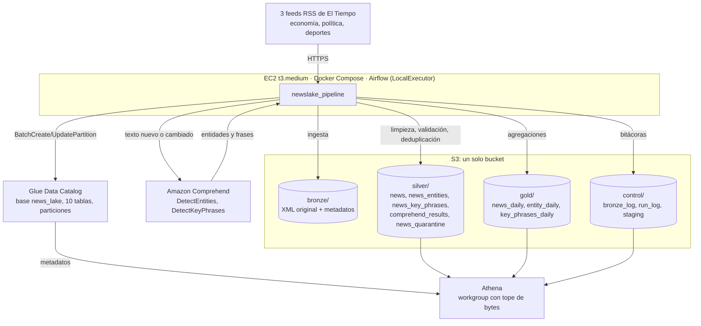
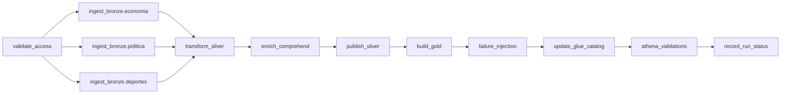

# Arquitectura del data lake de noticias

Un solo bucket S3 contiene las zonas Bronze, Silver y Gold. Airflow en una EC2 consulta tres feeds RSS de El Tiempo, guarda el XML original en Bronze, limpia y deduplica en Silver, enriquece con Comprehend, agrega en Gold, publica las particiones en el Glue Data Catalog y valida con Athena.

## Zonas del bucket

| Prefijo | Formato | Contenido | Inmutable |
| --- | --- | --- | --- |
| `bronze/source=<fuente>/ingestion_date=AAAA-MM-DD/run_id=<id>/` | XML + JSON | Respuesta original válida y `_metadata.json` (corrida, URL, UTC, HTTP, SHA-256, ubicación) | Sí (escritura condicional) |
| `silver/<tabla>/published_date=<fecha>/version=<run_id>/` | Parquet + Snappy | Noticias vigentes, entidades, frases clave | Cada versión es una carpeta nueva |
| `silver/news_quarantine/ingestion_date=<fecha>/run_id=<id>/` | Parquet | Rechazos con motivo y archivo de Bronze | Una partición por corrida |
| `silver/comprehend_results/analyzed_date=<fecha>/run_id=<id>/` | Parquet | Caché de análisis por hash de texto | Una partición por corrida |
| `gold/<tabla>/published_date=<fecha>/version=<run_id>/` | Parquet | Indicadores agregados | Cada versión es una carpeta nueva |
| `control/bronze_log/` | JSON (una línea) | Bitácora de ingesta por fuente y corrida, consultable en Athena | Se reescribe por corrida |
| `control/run_log/<run_id>__<fecha>.json` | JSON (una línea) | Bitácora de cada procesamiento, consultable en Athena | Un archivo por procesamiento: repetir no borra el anterior |
| `control/staging/run_id=<id>/` | JSON | Archivos de trabajo entre tareas | Expiran a los 3 días |
| `athena-results/` | CSV | Resultados de Athena | Expiran a los 7 días |
| `artifacts/` | — | Código y configuración publicados por Terraform | — |

## Tareas del DAG

| # | Requisito | Tarea |
| --- | --- | --- |
| 1 | Validación de configuración y acceso | `validate_access`: feeds.yml, S3, 10 tablas de Glue, workgroup de Athena, Comprehend; crea el pool `newslake_writer` |
| 2 | Extracción y escritura en Bronze | `ingest_bronze.<fuente>`: una tarea por feed, 3 reintentos solo para errores transitorios |
| 3 | Limpieza, validación y deduplicación | `transform_silver` (corre aunque falle una fuente: `trigger_rule=all_done`) |
| 4 | Enriquecimiento | `enrich_comprehend` con caché por hash |
| 5 | Publicación de Silver | `publish_silver`: escribe solo las particiones que cambiaron |
| 6 | Construcción de Gold | `build_gold` |
| 7 | Glue Data Catalog | `update_glue_catalog`: cambia los punteros de partición |
| 8 | Validaciones con Athena | `athena_validations`: `sql/athena/validations/*.sql` y comparación de bytes escaneados |
| 9 | Estado del procesamiento | `record_run_status`: `complete`, `partial` o `failed` en `control/run_log/` |

Control de concurrencia: `max_active_runs=1` y el pool `newslake_writer` de un cupo para las tareas que escriben en el lago.
