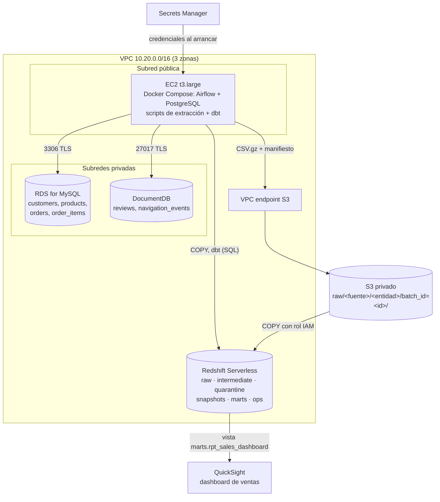
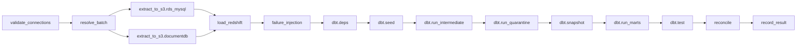

# Arquitectura del data warehouse en AWS

El pipeline extrae ventas de RDS for MySQL y DocumentDB, guarda cada lote como archivos inmutables en S3, los carga en Redshift Serverless con `COPY` y los transforma con dbt. Airflow y dbt corren en la misma EC2; el SQL que dbt genera se ejecuta en Redshift. QuickSight consume una vista de `marts`.

## Componentes

| Componente | Recurso Terraform | Responsabilidad |
| --- | --- | --- |
| Red | `module.network` (`modules/network`) | VPC, 3 subredes públicas, 3 privadas, Internet Gateway, endpoint gateway de S3. Sin NAT Gateway. |
| Fuente relacional | `aws_db_instance.mysql` | MySQL 8.4 privado, cifrado, accesible solo desde el security group de la EC2. |
| Fuente documental | `aws_docdb_cluster` + `aws_docdb_cluster_instance` | DocumentDB 5.0 con TLS obligatorio. |
| Zona de aterrizaje | `aws_s3_bucket.data` | Bucket privado, versionado, cifrado SSE-S3, sin acceso público y con TLS obligatorio. |
| Warehouse | `aws_redshiftserverless_namespace` + `_workgroup` | 8 RPU base, límite diario de RPU-hora, rol IAM para leer `raw/`. |
| Orquestación | `module.airflow` (`modules/ec2-airflow`) | EC2 con rol IAM, IMDSv2, Docker Compose, Airflow 2.11 (LocalExecutor) y dbt-redshift. |
| Secretos | `aws_secretsmanager_secret.app` | Contraseñas generadas por Terraform y endpoints. |
| Visualización | `aws_quicksight_data_source.redshift` (opcional) | Fuente de datos de QuickSight hacia Redshift. |

## Flujo de un lote

1. `validate_connections` comprueba S3, RDS, DocumentDB y Redshift y valida los parámetros.
2. `resolve_batch` fija `batch_id` y el modo (`full`, `incremental` o `reprocess`) y registra el lote en `ops.batch_runs`.
3. Las extracciones corren en paralelo y escriben `part-00000.csv.gz` y `_manifest.json` por entidad. Si el manifiesto ya existe, la entidad se reutiliza sin consultar la fuente.
4. `load_redshift` borra las filas del lote en `raw`, ejecuta `COPY` por entidad, compara conteos con los manifiestos y confirma todo en una transacción.
5. dbt construye las capas y ejecuta las pruebas.
6. `reconcile` compara indicadores agregados entre la capa válida y los marts y los guarda en `ops.reconciliation`.
7. `record_result` (siempre se ejecuta) deja el lote en `success` o `failed`.

## Capas en Redshift

| Esquema | Contenido | Quién lo escribe |
| --- | --- | --- |
| `raw` | Una tabla por entidad con todas las extracciones (`_batch_id`, `_extraction_mode`, `_extracted_at`, `_source`, `_loaded_at`) | Python + `COPY` |
| `intermediate` | `stg_*` (estado vigente por llave), `int_*__qa` (motivo de rechazo), `int_*__valid` | dbt (vistas) |
| `quarantine` | `quarantine_*` (rechazos actuales) y `quarantine_rejections_log` (historial por lote) | dbt |
| `snapshots` | `snap_dim_customer`, `snap_dim_product` (SCD tipo 2) | `dbt snapshot` |
| `seeds` | Municipios y festivos de Colombia | `dbt seed` |
| `marts` | 6 dimensiones, 3 hechos incrementales y la vista `rpt_sales_dashboard` | dbt |
| `ops` | `batch_runs`, `batch_entities`, `reconciliation` | Python |

`raw` está entre comillas en el SQL generado (`"raw"`) porque RAW es una palabra reservada de Redshift.
