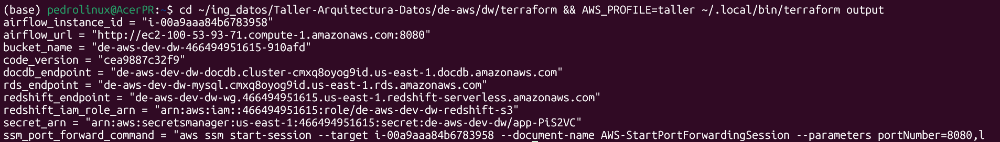
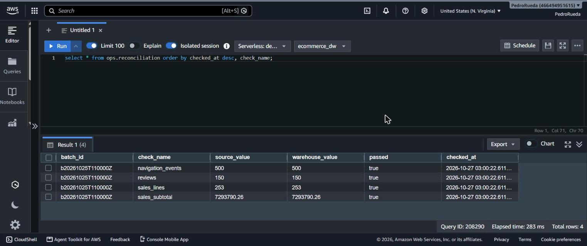
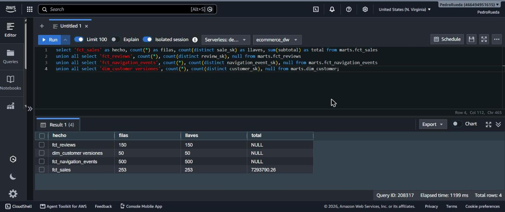
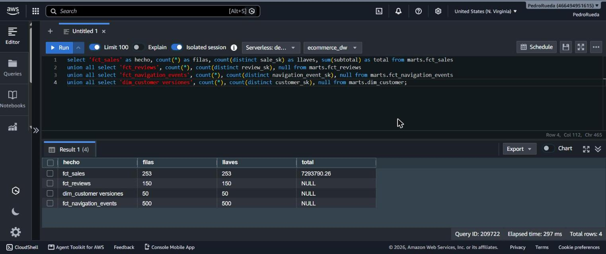
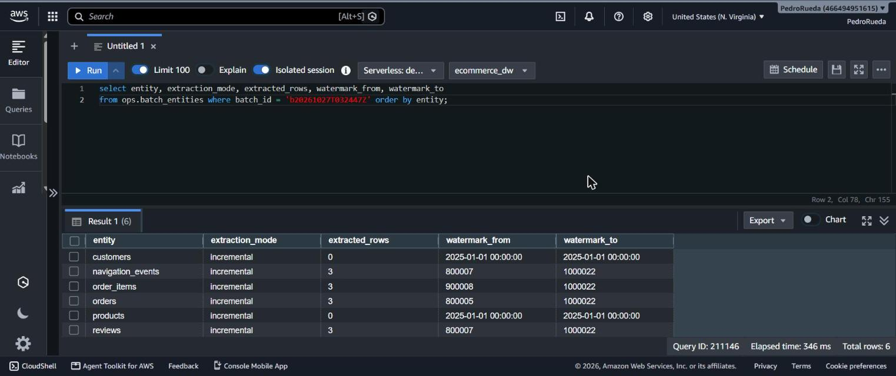
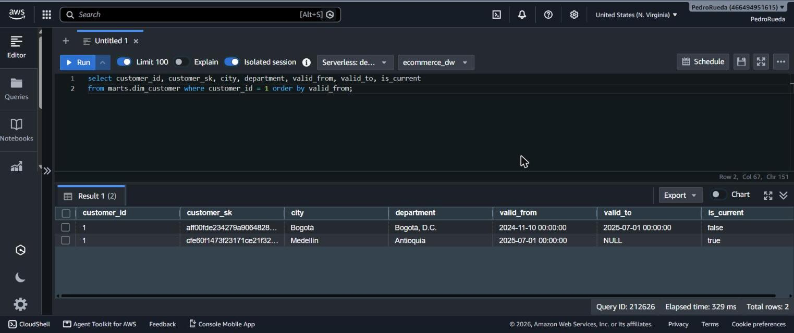
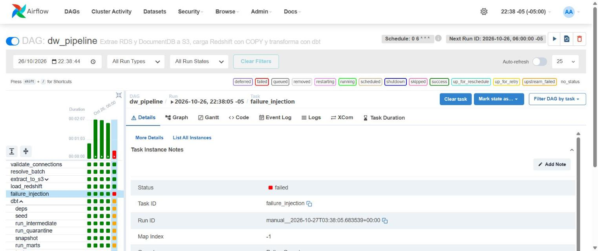
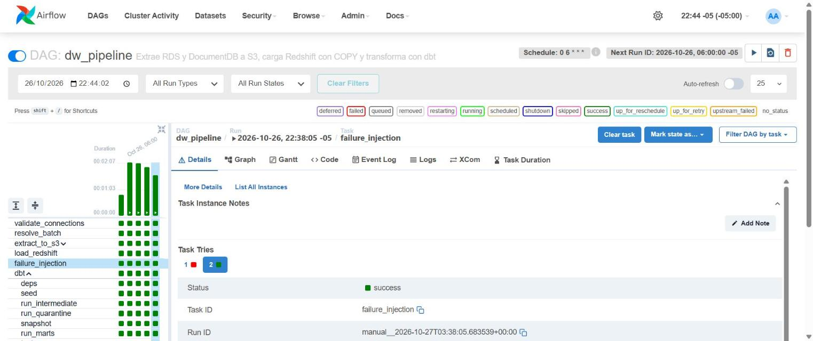
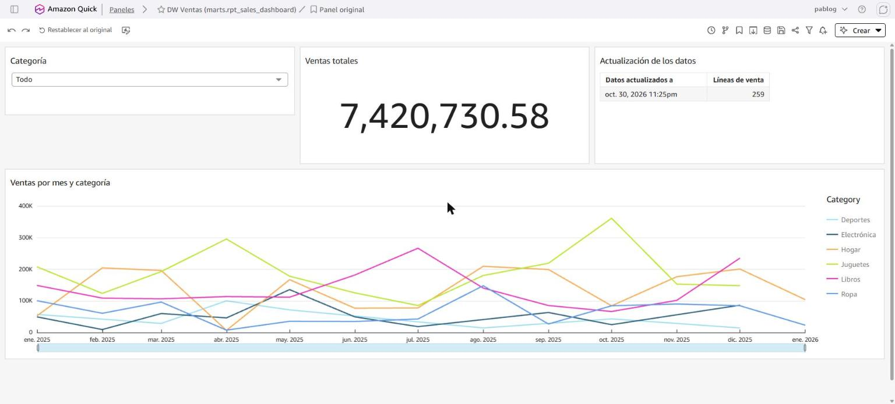
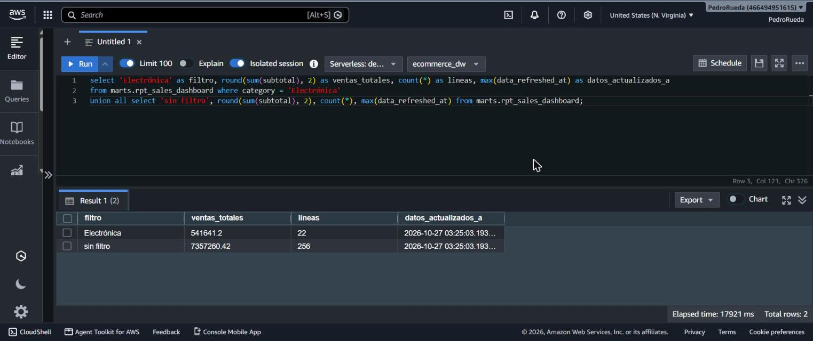

# Operación, lotes, recuperación y evidencias

## Cómo se identifica un lote

- `batch_id`: parámetro del DAG o, si está vacío, `b` + fecha lógica de la corrida en UTC (`b20261021T110000Z`). Es el mismo en todos los reintentos de esa corrida.
- En S3: `raw/<fuente>/<entidad>/batch_id=<id>/`. El `_manifest.json` registra fecha de extracción, modo, filas, columnas, hash SHA-256 del archivo y watermark desde/hasta.
- En Redshift: columna `_batch_id` de cada tabla `raw`, filas en `ops.batch_entities` y estado en `ops.batch_runs`.

## Cuándo cambia el estado y la marca de avance

| Momento | `ops.batch_runs.status` | Marca de avance |
| --- | --- | --- |
| `resolve_batch` | `running` (intentos +1) | Se lee la última marca de lotes `loaded`, `transformed` o `success` |
| Extracción | sin cambio | El manifiesto guarda `watermark_to`; aún no cuenta |
| `COMMIT` de `load_redshift` | `loaded` | **Aquí avanza**: se escribe `ops.batch_entities` en la misma transacción que el COPY |
| `dbt.run_marts` | `transformed` | — |
| `record_result` | `success` o `failed` con las tareas fallidas | Un lote `failed` no aporta marca; el siguiente vuelve a extraer desde la anterior y `stg_*` deduplica |

## Guía de evidencias paso a paso

Los pasos van en orden: cada escenario parte del estado que deja el anterior. Las capturas se guardan en [`docs/evidencias/`](evidencias/) con el nombre indicado; cada paso las enlaza, así este documento queda como informe de evidencias una vez tomadas.

### Antes de empezar

- **Airflow**: `terraform output -raw airflow_url` (o `make dw-tunnel` y <http://localhost:8080>). Usuario `airflow`; contraseña:

  ```bash
  aws secretsmanager get-secret-value --secret-id "$(terraform output -raw secret_arn)" \
    --query SecretString --output text | python3 -c "import json,sys; print(json.load(sys.stdin)['AIRFLOW_ADMIN_PASSWORD'])"
  ```

- **Redshift**: consola → *Redshift* → *Query editor v2* → workgroup `de-aws-…` → *Database user name and password*, base `ecommerce_dw`, usuario `dw_admin` y `REDSHIFT_PASSWORD` del mismo secreto. No use *Federated user*: ese usuario no tiene permisos sobre los esquemas que crea dbt.
- **Disparar un DAG con parámetros**: en Airflow, botón ▶ del DAG → *Trigger DAG w/ config* → pegar el JSON indicado → *Trigger*.
- En las capturas de Airflow deje visible el nombre del DAG, el `run_id` y el estado de las tareas; en las de Redshift, la consulta y su resultado.

### Paso 0. Infraestructura

| Captura | Dónde | Qué debe verse |
| --- | --- | --- |
| `00-terraform-apply.png` | Terminal | `Apply complete! Resources: … added` y la salida de `terraform output` |
| `01-s3-bucket.png` | S3 → bucket `de-aws-…` → *Permissions* | *Block all public access: On* y cifrado por defecto |
| `02-fuentes-rds-docdb.png` | RDS → *Databases* | La instancia MySQL y el clúster DocumentDB en *Available* |
| `03-redshift-workgroup.png` | Redshift Serverless → *Workgroups* | Workgroup *Available* y, en *Limits*, el límite diario de RPU-hora |
| `04-ec2-airflow.png` | EC2 → *Instances* | Instancia de Airflow *Running* |



### Paso 1. Carga inicial

1. Disparar `dw_source_ops` con `{"action": "generate", "seed": 42, "bad_records": 2}`. Esperar a que termine en verde.
2. Disparar `dw_pipeline` con `{"mode": "auto"}`. El primer lote queda `full`.
3. Abrir la vista *Graph* del run cuando todas las tareas estén en verde.
4. En S3, abrir `raw/mysql/orders/batch_id=<id>/`: debe tener `part-00000.csv.gz` y `_manifest.json`. Abrir el manifiesto (*Open*).
5. En la tarea `dbt.test` → *Logs*, bajar hasta el resumen `Done. PASS=… WARN=0 ERROR=0`.
6. Ejecutar en Redshift:

```sql
select batch_id, mode, status, attempts, loaded_at, finished_at from ops.batch_runs order by started_at;
select source, entity, extraction_mode, extracted_rows, loaded_rows, watermark_to from ops.batch_entities order by 1, 2;
select 'fct_sales' as hecho, count(*) as filas from marts.fct_sales
union all select 'fct_reviews', count(*) from marts.fct_reviews
union all select 'fct_navigation_events', count(*) from marts.fct_navigation_events;
select * from ops.reconciliation order by checked_at desc, check_name;
```

Con `seed=42` y `bad_records=2` los generadores son los de DE-DW y los conteos coinciden con los de la versión local (etapas 7 y 9 de DE-DW):

| Tabla | Filas |
| --- | --- |
| `"raw".mysql_orders` (lote inicial) | 106 |
| `"raw".mongo_reviews` (lote inicial) | 158 |
| `marts.fct_sales` | 253 |
| `marts.fct_reviews` | 150 |
| `marts.fct_navigation_events` | 500 |

| Captura | Qué debe verse |
| --- | --- |
| `10-source-ops-generate.png` | `dw_source_ops` en verde |
| `11-pipeline-carga-inicial.png` | Graph de `dw_pipeline` con las 7 etapas en verde: validación, extracción, carga, dbt, pruebas, conciliación y `record_result` |
| `12-s3-lote.png` | Carpeta `batch_id=<id>` con el archivo de datos y el manifiesto |
| `13-s3-manifiesto.png` | Contenido del `_manifest.json`: lote, fecha de extracción, filas, modo y watermark |
| `14-dbt-test.png` | Log de `dbt.test` con `PASS=…  ERROR=0` (pruebas de unicidad, obligatorios, relaciones y reglas de negocio) |
| `15-redshift-carga-inicial.png` | `ops.batch_runs` con el lote en `success` y modo `full`, y los conteos de los hechos |
| `16-conciliacion.png` | `ops.reconciliation` con `passed = true` en todas las verificaciones |




### Paso 2. Registros defectuosos

No requiere una ejecución nueva: los defectos se inyectaron en el paso 1. Se esperan, como en DE-DW, 4 clientes, 2 productos, 4 pedidos, 6 líneas, 8 reseñas y 8 eventos en cuarentena.

```sql
select entity, rejection_reason, source_batch_id, count(*)
from quarantine.quarantine_rejections_log
group by 1, 2, 3 order by 1, 2;

-- Cada fuente cumple stg = valid + quarantine
select (select count(*) from intermediate.stg_mysql__order_items) as stg,
       (select count(*) from intermediate.int_mysql__order_items__valid) as valid,
       (select count(*) from quarantine.quarantine_mysql__order_items) as quarantine;
```

| Captura | Qué debe verse |
| --- | --- |
| `20-cuarentena-motivos.png` | Rechazos por entidad, motivo y lote de origen |
| `21-stg-valid-quarantine.png` | `stg = valid + quarantine` |


### Paso 3. Repetir un lote exitoso

1. Ejecutar la consulta de abajo y tomar la captura **antes**.
2. Disparar `dw_pipeline` con `{"batch_id": "<id del paso 1>", "mode": "reprocess"}`.
3. En el log de `extract_to_s3.rds_mysql` aparece "ya publicado; se reutiliza sin consultar la fuente".
4. Repetir la consulta y tomar la captura **después**: los valores no cambian.

```sql
select 'fct_sales' as hecho, count(*) as filas, count(distinct sale_sk) as llaves, sum(subtotal) as total from marts.fct_sales
union all select 'fct_reviews', count(*), count(distinct review_sk), null from marts.fct_reviews
union all select 'fct_navigation_events', count(*), count(distinct navigation_event_sk), null from marts.fct_navigation_events
union all select 'dim_customer versiones', count(*), count(distinct customer_sk), null from marts.dim_customer;
```

`DELETE` + `COPY` reemplaza las filas del lote, los snapshots no ven un `updated_at` nuevo y los hechos usan `delete+insert`. La otra forma de repetición, la de DE-DW (`run_pipeline.sh --existing-sources`), es disparar `dw_pipeline` sin cambios en las fuentes: el lote nuevo es `incremental`, extrae 0 filas por entidad y los conteos tampoco cambian.

| Captura | Qué debe verse |
| --- | --- |
| `30-reproceso-antes.png` | Conteos, llaves y total antes |
| `31-reproceso-log.png` | Log de `extract_to_s3.rds_mysql` con "se reutiliza sin consultar la fuente" |
| `32-reproceso-despues.png` | Los mismos valores; `filas = llaves` (sin duplicados) |




### Paso 4. Nuevo lote incremental

1. Disparar `dw_source_ops` con `{"action": "append_batch", "batch_number": 2}`. El log dice `3 new orders`.
2. Disparar `dw_pipeline` con `{"mode": "auto"}`. El lote queda `incremental`.
3. Ejecutar:

```sql
select entity, extraction_mode, extracted_rows, watermark_from, watermark_to
from ops.batch_entities where batch_id = '<nuevo>' order by entity;
```

Cada hecho crece en 3 filas (253 → 256, 150 → 153, 500 → 503, igual que en DE-DW) y el lote extrae solo las filas nuevas. Use números de lote crecientes; `append_batch` rechaza uno menor al último agregado. Repetir `append_batch` con el mismo número informa `0 new orders` y el siguiente `dw_pipeline` no cambia los hechos.

| Captura | Qué debe verse |
| --- | --- |
| `40-append-batch.png` | Log de `dw_source_ops` con `3 new orders` |
| `41-pipeline-incremental.png` | Graph de `dw_pipeline` en verde |
| `42-batch-entities-incremental.png` | `extraction_mode = incremental`, `extracted_rows` = 3 en pedidos y watermark desde/hasta |
| `43-hechos-incremental.png` | Conteos de los hechos con +3 |



### Paso 5. Cambio en un atributo historizado

1. Disparar `dw_source_ops` con `{"action": "simulate_changes", "changed_at": "2025-07-01T00:00:00"}`.
2. Disparar `dw_pipeline` con `{"mode": "auto"}`.
3. Ejecutar:

```sql
select customer_id, customer_sk, city, department, valid_from, valid_to, is_current
from marts.dim_customer where customer_id = 1 order by valid_from;
```

Aparecen dos versiones: la anterior con `valid_to = 2025-07-01` y la vigente con `is_current = true`. Las ventas anteriores al cambio siguen apuntando a la versión vieja.

| Captura | Qué debe verse |
| --- | --- |
| `50-simulate-changes.png` | `dw_source_ops` en verde |
| `51-scd2-dim-customer.png` | Dos versiones del cliente 1, la anterior cerrada y la vigente con `is_current = true` |



### Paso 6. Fallo controlado y reejecución

1. Disparar `dw_pipeline` con `{"simulate_failure": true}`. Falla `failure_injection` después de confirmar la carga en `raw`; `record_result` marca el lote `failed`.
2. Recuperar con una de dos opciones:
   - En la vista *Grid*, clic en `failure_injection` → *Clear* con *Downstream* marcado. El marcador en `control/failure_injection/` hace que la tarea pase en el segundo intento.
   - O disparar de nuevo con `{"batch_id": "<id>", "mode": "reprocess"}`.
3. Verificar que no hay pérdida ni duplicados:

```sql
select batch_id, status, attempts, message from ops.batch_runs where batch_id = '<id>';
select count(*), count(distinct order_item_id) from "raw".mysql_order_items where _batch_id = '<id>';
select * from ops.reconciliation where batch_id = '<id>';
```

| Captura | Qué debe verse |
| --- | --- |
| `60-fallo-grid.png` | `failure_injection` en rojo y las tareas siguientes en `upstream_failed` |
| `61-fallo-log.png` | Log con `[batch=<id> task=failure_injection] Fallo controlado…`: identifica lote y tarea |
| `62-fallo-estado.png` | `ops.batch_runs` con el lote en `failed` y el mensaje con la tarea fallida |
| `63-recuperado-grid.png` | El mismo run en verde después del *Clear* |
| `64-recuperado-sql.png` | Lote en `success`, `attempts = 2`, `count = count distinct` y conciliación en `true` |




### Paso 7. Dashboard de QuickSight

Siga [quicksight.md](quicksight.md) para la suscripción, la fuente de datos y el dataset sobre `marts.rpt_sales_dashboard`. Luego ejecute en Redshift la consulta de validación con el mismo filtro aplicado en el dashboard:

```sql
select round(sum(subtotal), 2) as ventas_totales, count(*) as lineas, max(data_refreshed_at) as datos_actualizados_a
from marts.rpt_sales_dashboard
where category = 'Electrónica';
```

| Captura | Qué debe verse |
| --- | --- |
| `70-quicksight-dashboard.png` | Dashboard publicado: gráfica de ventas por fecha y categoría, KPI de ventas totales y el control de filtro |
| `71-quicksight-filtrado.png` | El dashboard con el filtro `category = Electrónica` y la fecha de actualización visible |
| `72-sql-validacion-kpi.png` | La consulta de validación con el mismo valor y la misma fecha que la captura anterior |
| `73-spice-refresh.png` | Solo con SPICE: *Dataset → Refresh* con la última actualización exitosa |




### Paso 8. Demostración: un lote nuevo hasta el dashboard

1. `dw_source_ops` con `{"action": "append_batch", "batch_number": 3}` y luego `dw_pipeline` en `auto`.
2. Si el dataset es SPICE, *Refresh now*.
3. El KPI sin filtro aumenta en el subtotal de las 3 líneas nuevas y `data_refreshed_at` cambia.

| Captura | Qué debe verse |
| --- | --- |
| `80-demo-dashboard-despues.png` | El KPI y la fecha de actualización después del lote 3 |

### Paso 9. Eliminar los recursos

`terraform destroy` desde `dw/terraform` (ver [despliegue.md](despliegue.md#6-eliminar-todo)).

| Captura | Qué debe verse |
| --- | --- |
| `90-terraform-destroy.png` | `Destroy complete! Resources: … destroyed` |

## Dónde mirar cuando algo falla

- Cada línea de log empieza con `[batch=<id> task=<tarea>]`.
- `validate_connections`: red o credenciales (security groups, secreto).
- `load_redshift`: el log muestra las filas de `sys_load_error_detail` con la columna y el motivo del rechazo del COPY.
- `dbt.test`: el log lista la prueba que falló; `retries=0` porque una prueba fallida no es transitoria.
- `reconcile`: `ops.reconciliation` guarda los valores comparados.
